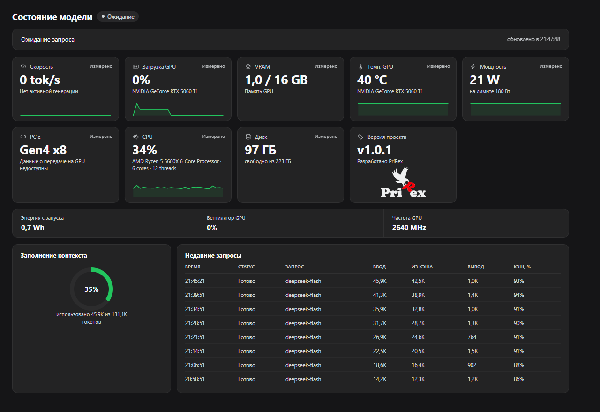

[English](#english) | [Русский](#русский)

<p align="center">
  
</p>

<h1 align="center">PriRex Monitor</h1>

<p align="center"><em>GPU · CPU · VRAM · power · energy · token speed · context fill — live telemetry for DeepSeek Harness, on one page.</em></p>

<p align="center">
  <a href="https://github.com/Prirex/PriRex-Monitoring-DeepSeek-Harness"></a>
  <a href="https://github.com/Prirex/PriRex-Monitoring-DeepSeek-Harness/blob/main/package.json"></a>
  <a href="LICENSE"></a>
</p>

<p align="center">
  
</p>

<p align="center"><sub>The page: hardware cards, context ring and the last requests. Hardware numbers are read from the machine; the token rows come from a demo session.</sub></p>

---

## English

### Overview

PriRex Monitor adds a **Monitor** entry to the DSH sidebar plus a full telemetry page in the main
panel. The host half samples the machine on a fixed interval, accumulates token usage from the
session event stream, and publishes the snapshot two ways: a JSON route and an SSE stream that keeps
the page live without polling.

| Half | File | Role |
|---|---|---|
| Host | `index.js` | samples sensors, accumulates token usage, serves two local routes |
| Browser | `client.js` (built from `client.template.js`) | sidebar entry + page, `React.createElement` only, styled with host theme tokens |

### What the page shows

| Card | Content |
|---|---|
| Speed | tokens/s of the session; `0 tok/s` means the model is idle |
| GPU load | utilization %, with a 40-point sparkline |
| VRAM | used / total GB |
| GPU temperature | °C — the sparkline turns warning-colored above the configured threshold |
| Power | draw / limit, W |
| PCIe | link generation and width (`Gen4 x16`) |
| CPU | total load % |
| Disk | read throughput (B/s) where the platform reports it; on Windows, which has no byte-rate provider, it shows free space of the system volume |

Below the cards: **energy since host start** (Wh, integrated from GPU power draw), **GPU fan** (%),
**GPU clock** (MHz), a **context fill** ring (used / window tokens) and a **recent requests** table —
time, status, model, input tokens, cache-read tokens, output tokens, cache share.

The top-right corner of the page holds a compact **RU / EN / ZH** switch. The page then re-renders
in that language — titles, card labels, statuses, table headers and number/time formatting — and the
choice is remembered in the browser's `localStorage`.

GPU numbers come from `nvidia-smi`, because `systeminformation` does not expose utilization, fan
speed or PCIe link width on Windows. Without an NVIDIA tool the module falls back to
`systeminformation`, so AMD/Intel machines still get load, temperature, power and VRAM.

### Why PriRex Monitor

- **Real sensors, not guesses** — `nvidia-smi` reports what the driver knows: utilization, VRAM, fan,
  power draw against the limit, temperature, SM clock and the PCIe link; every other platform falls
  back to `systeminformation` instead of showing nothing.
- **One page instead of three tools** — hardware, the context window and the cost of the current
  session sit together, so a slow answer can be explained without leaving the chat.
- **Live, not polled** — samples arrive over SSE every 500 ms; the page falls back to a 2 s poll only
  if the stream is unavailable.
- **Zero setup** — no config file to write, no build during installation (`client.js` is committed),
  no service to run; the plugin samples the machine it is already installed on.
- **Local by design** — two same-origin `GET` routes, no outbound traffic, no filesystem access, and
  a `nvidia-smi` call with a fixed argument vector.
- **Fits the host** — colors come from DSH theme tokens, so the page matches light and dark themes
  without a second stylesheet.
- **Three languages** — the page ships with Russian, English and Chinese; the top-right switch
  re-renders every label, status and number format without a reload.

### Changelog

#### v1.0.2 — current update
- **Language switch (RU / EN / ZH)** in the top-right corner of the page; the choice is stored in
  `localStorage` and applied again on the next launch.
- The sidebar entry's label follows the saved language on the next host start.
- Card headers, statuses, the context ring, the requests table and number/time formatting are all
  localized (decimal separators and clock format follow the locale).
- Docs: fixed the broken encoding of the package description.

#### v1.0.1
- The disk card now works on Windows: when the platform has no byte-rate provider it shows free
  space instead of an empty card.
- Screenshot and the benefit list added to the docs.

#### v1.0.0
- Initial release: live hardware and token telemetry over an SSE stream plus a JSON fallback route.

### Installation

Requirements: DeepSeek Harness with the Web surface, Node.js ≥ 20.

**From GitHub** — *Plugins → Install bundle → GitHub* and use the repository name
`Prirex/PriRex-Monitoring-DeepSeek-Harness`. `client.js` is committed, so nothing is built during
installation.

**From a local folder** — *Plugins → Install bundle → local path* and point it at this folder. DSH
links it with a directory junction at `node_modules/prirex-monitoring-deepseek-harness`.

> These two routes must not occupy the same slot at once. If a local link is still in place and you
> then install the GitHub version, pnpm cannot replace the junction and fails with
> `[ERR_PNPM_EPERM] importPackage`. Close DSH and drop the link first — only the junction is
> removed, the project folder stays intact:
>
> ```powershell
> cmd /c rmdir "%USERPROFILE%\.dsh\profiles\desktop\node_modules\prirex-monitoring-deepseek-harness"
> ```

The bundled [`cordis.patch.yml`](cordis.patch.yml) inserts the `prirex-monitor` row automatically, so
no manual patch editing is required.

### Configuration

Defaults live in `index.js`; override them in the profile's `cordis.patch.yml`:

```yaml
- id: prirex-monitor
  name: prirex-monitoring-deepseek-harness
  config:
    refreshMs: 500              # sampling interval, floored at 200 ms
    overheatC: 80               # temperature that turns the sparkline warning-colored
    ratesUsdPerMillion:         # used for tokens.costUsd in the JSON snapshot
      input: 0.27
      output: 1.1
```

### HTTP routes

Registered on the DSH web server, both local-only by design:

| Route | Format | Notes |
|---|---|---|
| `/api/prirex-monitor/telemetry` | JSON snapshot | `GET` / `HEAD` only |
| `/api/prirex-monitor/stream` | SSE | pushes every fresh sample, `retry: 2000` hint |

The client consumes the stream and falls back to polling the JSON route every 2 s when the stream is
unavailable.

### Security

- `GET`/`HEAD` only (`405` otherwise); `Origin` must match `Host`; `Sec-Fetch-Site: cross-site` is
  rejected — all `403`.
- No outbound network traffic, no filesystem access, no shell: `nvidia-smi` is spawned with a fixed
  argument vector.
- Telemetry updates are wrapped so a failure can never disturb session commits.

Details and the reporting process: [`SECURITY.md`](SECURITY.md).

### Project layout

```text
index.js               host half: sensors, token accounting, HTTP routes
client.template.js     browser half source (React.createElement, no JSX)
client.js              built artifact — committed, edit the template instead
scripts/gen-client.mjs build step: template -> client.js
scripts/smoke-client.mjs  evaluates client.js in a stubbed loader
cordis.patch.yml       loader patch that inserts the plugin row
locale/                panel metadata (ru, en, zh)
icon.svg               sidebar and page icon
```

### Development

```bash
pnpm install
pnpm run build   # node scripts/gen-client.mjs
pnpm run smoke   # evaluates client.js and checks the registration contract
pnpm run check   # build + smoke
```

Edit `client.template.js`, never `client.js`: the build copies the template verbatim and the smoke
test fails on a stale artifact.

### License

MIT — see [`LICENSE`](LICENSE).

---

## Русский

### Описание

PriRex Monitor добавляет в боковую панель DSH пункт **Монитор** и открывает полноценную страницу
телеметрии в центральной панели. Хост-часть опрашивает железо с фиксированным интервалом,
накапливает расход токенов из потока событий сессии и отдаёт снимок двумя способами: JSON-маршрутом
и SSE-потоком, который обновляет страницу без опроса.

| Часть | Файл | Роль |
|---|---|---|
| Хост | `index.js` | опрос датчиков, учёт токенов, два локальных маршрута |
| Браузер | `client.js` (собирается из `client.template.js`) | пункт меню и страница, только `React.createElement`, оформление на токенах темы |

### Что показывает страница

| Карточка | Содержимое |
|---|---|
| Скорость | токенов/с текущей сессии, по приращению между замерами |
| Загрузка GPU | процент загрузки и спарклайн на 40 точек |
| VRAM | занято / всего, ГБ |
| Темп. GPU | °C — спарклайн подсвечивается при превышении настроенного порога |
| Мощность | потребление / лимит, Вт |
| PCIe | поколение и ширина линии (`Gen4 x16`) |
| CPU | суммарная загрузка, % |
| Диск | скорость чтения (Б/с) там, где платформа её отдаёт; на Windows, где провайдера байт/с нет, показывается свободное место системного тома |

Ниже карточек: **энергия с запуска хоста** (Вт·ч, интеграл мощности GPU), **вентилятор GPU** (%),
**частота GPU** (МГц), кольцо **заполнения контекста** (использовано / окно) и таблица **недавних
запросов** — время, статус, модель, ввод, из кэша, вывод, доля кэша.

В правом верхнем углу страницы — компактный переключатель **RU / EN / ZH**. Страница сразу
перерисовывается на выбранном языке: заголовки, подписи карточек, статусы, шапка таблицы, а также
формат чисел и времени; выбор сохраняется в `localStorage` браузера.

Данные GPU читаются через `nvidia-smi`: `systeminformation` не отдаёт загрузку, обороты вентилятора
и ширину PCIe. Без NVIDIA-инструмента модуль переходит на `systeminformation`, поэтому на
AMD/Intel всё равно видны загрузка, температура, мощность и VRAM.

### Преимущества

- **Настоящие датчики, а не оценки** — `nvidia-smi` отдаёт то, что знает драйвер: загрузку, VRAM,
  вентилятор, потребление к лимиту, температуру, частоту SM и линию PCIe; на остальных платформах
  работает откат на `systeminformation`, а не пустая карточка.
- **Одна страница вместо трёх утилит** — железо, окно контекста и стоимость текущей сессии рядом,
  поэтому медленный ответ объясняется без выхода из чата.
- **Живые данные, а не опрос** — замеры приходят по SSE каждые 500 мс; опрос раз в 2 с включается
  только если поток недоступен.
- **Без настройки** — не нужно писать конфиг, собирать при установке (`client.js` закоммичен) и
  держать отдельный сервис: плагин читает машину, на которой уже установлен.
- **Локально по замыслу** — два same-origin `GET`-маршрута, нет исходящего трафика, нет доступа к
  файловой системе, `nvidia-smi` вызывается с фиксированным набором аргументов.
- **Под стиль хоста** — цвета берутся из токенов темы DSH, поэтому страница совпадает со светлой и
  тёмной темой без второго набора стилей.
- **Три языка** — страница говорит на русском, английском и китайском; переключатель справа сверху
  перерисовывает все подписи, статусы и форматы чисел без перезагрузки.

### Обновления

#### v1.0.2 — текущее обновление
- **Переключатель языка (RU / EN / ZH)** в правом верхнем углу страницы; выбор сохраняется в
  `localStorage` и применяется при следующем запуске.
- Название пункта в боковой панели берётся из сохранённого языка при следующем старте хоста.
- Локализованы заголовки карточек, статусы, кольцо контекста, таблица запросов, а также формат
  чисел и времени (разделитель дробной части и формат часов по локали).
- Документация: исправлена испорченная кодировка описания пакета.

#### v1.0.1
- Карточка диска теперь работает на Windows: если платформа не отдаёт байты в секунду, показывается
  свободное место, а не пустая карточка.
- В документацию добавлены скриншот и список преимуществ.

#### v1.0.0
- Первый выпуск: живая телеметрия железа и токенов через SSE-поток и JSON-маршрут как запасной путь.

### Установка

Требования: DeepSeek Harness с веб-интерфейсом, Node.js ≥ 20.

**С GitHub** — *Плагины → Установить бандл → GitHub*, репозиторий
`Prirex/PriRex-Monitoring-DeepSeek-Harness`. `client.js` закоммичен, при установке ничего не
собирается.

**Из локальной папки** — *Плагины → Установить бандл → локальный путь* и указать эту папку. DSH
подключает её junction-ссылкой `node_modules/prirex-monitoring-deepseek-harness`.

> Оба способа не должны занимать одно место одновременно. Если локальная ссылка уже стоит, а вы
> ставите версию с GitHub, pnpm не может заменить junction и падает с
> `[ERR_PNPM_EPERM] importPackage`. Закройте DSH и сначала уберите ссылку — удаляется только
> junction, папка проекта остаётся на месте:
>
> ```powershell
> cmd /c rmdir "%USERPROFILE%\.dsh\profiles\desktop\node_modules\prirex-monitoring-deepseek-harness"
> ```

Входящий в комплект [`cordis.patch.yml`](cordis.patch.yml) сам вставляет строку `prirex-monitor` —
править патч вручную не нужно.

### Настройки

Значения по умолчанию заданы в `index.js`, переопределяются в `cordis.patch.yml` профиля:

```yaml
- id: prirex-monitor
  name: prirex-monitoring-deepseek-harness
  config:
    refreshMs: 500              # интервал опроса, минимальное значение — 200 мс
    overheatC: 80               # температура, при которой спарклайн становится предупреждающим
    ratesUsdPerMillion:         # используются для tokens.costUsd в JSON-снимке
      input: 0.27
      output: 1.1
```

### HTTP-маршруты

Регистрируются на веб-сервере DSH, оба локальные по замыслу:

| Маршрут | Формат | Замечания |
|---|---|---|
| `/api/prirex-monitor/telemetry` | JSON-снимок | только `GET` / `HEAD` |
| `/api/prirex-monitor/stream` | SSE | присылает каждый свежий замер, подсказка `retry: 2000` |

Клиент читает поток, а если поток недоступен — опрашивает JSON-маршрут раз в 2 секунды.

### Безопасность

- Только `GET`/`HEAD` (иначе `405`); `Origin` должен совпадать с `Host`; запросы с
  `Sec-Fetch-Site: cross-site` отклоняются — во всех случаях `403`.
- Нет исходящего трафика, нет доступа к файловой системе, нет оболочки: `nvidia-smi` запускается
  с фиксированным набором аргументов.
- Обновление телеметрии обёрнуто так, что сбой не может помешать фиксации сессии.

Подробности и порядок сообщения о проблемах: [`SECURITY.md`](SECURITY.md).

### Структура проекта

```text
index.js               хост-часть: датчики, учёт токенов, HTTP-маршруты
client.template.js     исходник браузерной части (React.createElement, без JSX)
client.js              собранный артефакт — закоммичен, править нужно шаблон
scripts/gen-client.mjs шаг сборки: шаблон -> client.js
scripts/smoke-client.mjs  прогоняет client.js в заглушке загрузчика
cordis.patch.yml       патч загрузчика, вставляющий строку плагина
locale/                метаданные панели (ru, en, zh)
icon.svg               иконка для панели и страницы
```

### Разработка

```bash
pnpm install
pnpm run build   # node scripts/gen-client.mjs
pnpm run smoke   # прогоняет client.js и проверяет контракт регистрации
pnpm run check   # сборка + smoke
```

Правьте `client.template.js`, а не `client.js`: сборка копирует шаблон как есть, а smoke-тест падает
на устаревшем артефакте.

### Лицензия

MIT — см. [`LICENSE`](LICENSE).
